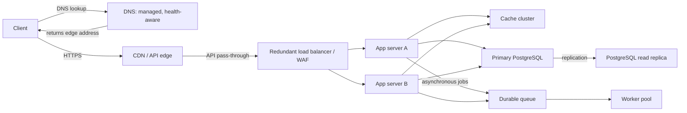

# QuickNotes service architecture

## Requirements

### Functional

- Authenticate users and ensure each user can access only their own notes and tags.
- Create, list, retrieve, update, and delete notes.
- Create and list tags, and associate or disassociate tags with notes.
- Support pagination, input validation, and actionable API errors.

### Non-functional

- Serve 1 million registered accounts with horizontal application scaling.
- Keep note reads responsive and highly available across an application instance failure.
- Protect data in transit and at rest, maintain backups, and provide recovery procedures.
- Isolate tenants, apply rate limits, and expose metrics, logs, and traces without logging note contents.

## Capacity estimate for 1 million users

Planning assumptions: 1,000,000 registered users; 20% (200,000) active on an average day; five note-list/read requests per active user per day; and one new 1 KiB note per active user per day. These estimates exclude retries, background work, and attachments.

| Measure | Estimate |
|---|---:|
| Reads per day | 1,000,000 |
| Average reads per second | 1,000,000 / 86,400 = **11.6 rps** |
| Writes per day | 200,000 |
| Average writes per second | 200,000 / 86,400 = **2.3 rps** |
| Peak planning rate (10x average) | **116 read rps**, **23 write rps** |
| New note data per year | 200,000 × 365 × 1 KiB = **about 74.6 GB raw/year** |
| Provisioned storage growth | **about 150 GB/year**, allowing roughly 2x for row/index overhead; replicas and backups are additional copies |

These are initial capacity figures, not a claim about measured production traffic. Validate against telemetry, retention policy, note sizes, and actual peak-to-average ratios.

## Architecture

The CDN caches versioned static client assets near users, while personalized API responses are not shared-cacheable by default.

| Component | Problem it solves |
|---|---|
| Client | Provides the user interface and sends authenticated API requests over HTTPS. |
| DNS | Routes the service name to healthy edge infrastructure and supports controlled failover. |
| CDN | Reduces latency and origin load for static assets, and absorbs geographically distributed traffic. |
| Load balancer / WAF | Distributes requests across healthy app instances and filters common malicious traffic. |
| App servers (A and B) | Run stateless API logic and validation, allowing independent horizontal scaling. |
| Cache cluster | Reduces repeated database reads for safe, short-lived data and improves response latency. |
| Primary database | Provides durable transactional writes and the authoritative source of truth. |
| Read replica | Scales read capacity and serves eligible read traffic, accepting bounded replication lag. |
| Durable queue | Buffers asynchronous jobs so traffic bursts do not block synchronous API responses. |
| Worker pool | Processes queued work such as notifications and cleanup with retry and dead-letter handling. |

## Request flows

### `GET /v1/notes`

1. The client resolves the QuickNotes API hostname through DNS and establishes TLS to the edge.
2. The CDN passes this authenticated, user-specific API request through rather than serving a shared cached response.
3. The load balancer/WAF applies request controls and selects a healthy app server.
4. The app server validates the access token, scopes the query to its user, and checks the cache for an eligible key.
5. On a cache miss, it queries the read replica using the user's scope and cursor; it can use the primary if the endpoint requires read-after-write freshness.
6. The app server returns the paginated JSON response and may populate the short-lived cache. The client handles `200` and documented error responses.

### `POST /v1/notes`

1. The client submits JSON over TLS to the API hostname with its access token.
2. DNS, CDN pass-through, WAF, and load balancer deliver the request to a healthy app server.
3. The app server authenticates the user, validates the title/body and any tags, then starts a database transaction.
4. It inserts the note and requested associations into the primary database, which commits durably.
5. It invalidates or updates relevant cache entries and places non-critical follow-up work on the durable queue.
6. It returns `201 Created` with the persisted note and its identifier only after the database commit; workers handle queued work asynchronously.

## Trade-offs and availability

- **Read replicas improve read throughput but introduce replication lag.** Ordinary lists may tolerate bounded staleness; writes are acknowledged by the primary, and read-after-write paths can read from the primary or briefly bypass cache.
- **Caching improves latency but creates invalidation and consistency complexity.** Cache only safe, user-scoped data with short TTLs, invalidate on writes, and fall back to the database when cache nodes are unavailable.
- **Asynchronous queue processing protects request latency but is eventually consistent.** The queue uses durable delivery, idempotent workers, bounded retries, and a dead-letter queue so failures are recoverable.

No single application instance is a single point of failure: the load balancer routes around unhealthy instances and at least two stateless app servers run across failure domains. DNS, CDN/WAF, and load balancing use managed redundant services; database availability uses automated primary failover with a replica, backups, and tested restore procedures. Cache loss degrades performance but not correctness because the database remains authoritative. The queue and worker processes are replicated, and queued work can resume after worker replacement.
